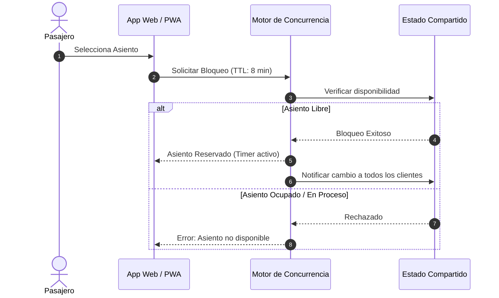

<p align="center">
  
</p>

<p align="center">
  <strong>Plataforma Integral de Reserva, Control de Aforo y Despacho Interurbano en Tiempo Real</strong>
</p>

<p align="center">
  
  
  
  
</p>

---

## 🚐 ¿Qué es Cupora?

**Cupora** es una solución de circuito cerrado diseñada específicamente para modernizar y tecnificar el transporte interurbano en minivanes y combis (rutas de media y corta distancia). El sistema resuelve la sobreventa y la falta de trazabilidad en paraderos mediante:

1. **Cero Sobreventa (Bloqueo Atómico):** Asignación garantizada de asientos con bloqueo temporal en tiempo real.
2. **Croquis Interactivo Dinámico:** Mapas de asientos configurables para unidades de **11, 14 y 15 pasajeros**.
3. **Validación QR 100% Offline:** Boletos electrónicos criptográficamente firmados (JWT) verificables en ruta por el conductor sin necesidad de internet.
4. **Manifiesto Digital y Despacho:** Control estricto de aforo, control de equipaje, lista oficial de pasajeros y transición de estados operativos (`EMBARCANDO`, `LLENO`, `EN_RUTA`, `FINALIZADO`).

---

## 🧭 Plan de Implementación: De la Demo al Despliegue

Para poder visualizar, validar y presentar el sistema de inmediato **sin necesidad de contratar infraestructura de servidor previa**, el proyecto se desarrollará en dos fases estratégicas:

### 🌟 Fase 1: Demo Central Interactiva (Web + Multi-Rol PWA)
Implementación de un entorno web unificado y reactivo con **simulación de tiempo real local** (utilizando `BroadcastChannel`, `LocalStorage` y `Service Workers` para sincronización instantánea entre pestañas):

* 🌐 **Landing Page Central:** Presentación corporativa de Cupora, información de rutas, cotizador rápido e invitaciones de descarga PWA.
* 🎫 **PWA Pasajero:**
  - Búsqueda de salidas y rutas interurbanas.
  - Selección de asientos en el croquis interactivo con temporizador de retención (TTL).
  - Check-in y emisión de boleto con código QR dinámico.
* 📱 **PWA Conductor / Chofer:**
  - Escáner de boletos QR con cámara (soporte offline mediante verificación de firma).
  - Vista del aforo del vehículo en tiempo real.
  - Manifiesto digital de pasajeros en cabina.
  - Cambio de estados de despacho del vehículo.
* 🖥️ **Panel Despacho & Administrador:**
  - Tablero de control de salidas e itinerarios.
  - Asignación de conductores y minivanes.
  - Monitor de ocupación global y arqueo de caja.
* 🔄 **Selector Rápido de Roles (Modo Demo):** Barra flotante para alternar entre Pasajero, Chofer y Administrador en un solo clic, permitiendo probar la reserva en una ventana y ver la validación en otra simultáneamente.

### 🚀 Fase 2: Backend & Microservicios para Producción
* **Motor Backend:** API REST + WebSockets (NestJS / FastAPI).
* **Bloqueo Atómico:** Redis (`SET key value NX EX 480`) para TTL de 8 minutos por asiento.
* **Persistencia ACID:** PostgreSQL (`SELECT ... FOR UPDATE`) para confirmación de transacciones sin colisiones.
* **Infraestructura:** Contenedores Docker y despliegue orquestado.

---

## 🎨 Identidad Visual y Recursos

Los recursos gráficos oficiales se encuentran alojados en [`public/assets/`](public/assets/):

| Recurso | Archivo | Uso Principal |
| :--- | :--- | :--- |
| **Logo Completo** | [`public/assets/logo.png`](public/assets/logo.png) | Cabecera del portal web, landing page corporativa, reportes y boletos PDF. |
| **Isotipo / App Icon** | [`public/assets/icon.png`](public/assets/icon.png) | Favicon del sitio, icono instalable de la PWA (manifest), splash screens y avatares. |

---

## 📂 Estructura del Repositorio

```text
Cupora/
├── public/
│   └── assets/
│       ├── logo.png             # Logotipo corporativo completo
│       └── icon.png             # Isotipo oficial para app y PWA
├── src/
│   ├── components/              # Componentes UI (Croquis, QR Scanner, Navbar, Modales)
│   ├── modules/
│   │   ├── landing/             # Web central informativa
│   │   ├── passenger/           # PWA Pasajeros (Reserva, Croquis, Boletos)
│   │   ├── driver/              # PWA Choferes (Escáner QR, Manifiesto, Despacho)
│   │   └── admin/               # Panel Administrativo y Despachadores
│   ├── services/                # Capa de datos (Mock Realtime Sync / BroadcastChannel / API)
│   ├── types/                   # Tipos TypeScript compartidos (Trip, Seat, Ticket, User)
│   └── utils/                   # Utilidades criptográficas (JWT offline, generador QR)
├── backend/                     # (Fase 2) Microservicio API, Redis Locks & Postgres DB
├── docker-compose.yml           # (Fase 2) Orquestación de infraestructura local
├── package.json
└── README.md                    # Documentación general del proyecto
```

---

## ⚡ Inicio Rápido en Desarrollo Local

### 1. Clonar el repositorio
```bash
git clone https://github.com/xllnyxthornllx/Cupora.git
cd Cupora
```

### 2. Instalar dependencias
```bash
pnpm install
```

### 3. Iniciar el entorno de demostración
```bash
pnpm run dev
```
Abre tu navegador en `http://localhost:5173`. Podrás abrir dos ventanas paralelas (una como Pasajero y otra como Conductor/Administrador) para comprobar la reactividad y sincronización de asientos y boletos en vivo.

---

## 🔐 Especificaciones Técnicas Clave

### Bloqueo Atómico de Asientos


### Validación QR Offline
* **Generación:** Al pagar el boleto, se genera un token cifrado firmado con clave privada que incluye: `trip_id`, `seat_id`, `dni`, `passenger_name` y `timestamp`.
* **Lectura:** La PWA del conductor valida la firma criptográfica con la clave pública almacenada localmente en la caché de la app, permitiendo verificar la legitimidad del pasaje en plena carretera sin conexión 4G/5G.

---

## 👥 Equipo y Contribuciones

* **Desarrollador Principal:** [NYXTHORN (@xllnyxthornllx)](https://github.com/xllnyxthornllx)
* **Licencia:** Proyecto Privado / Propietario.
